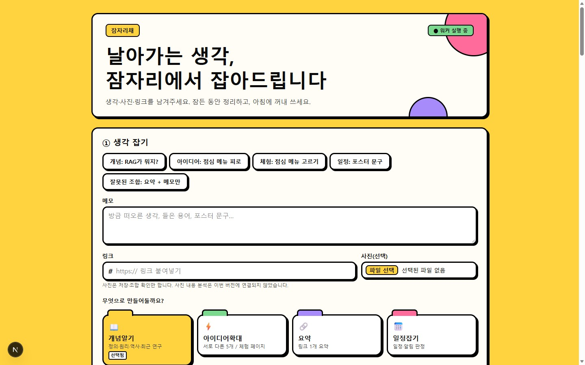
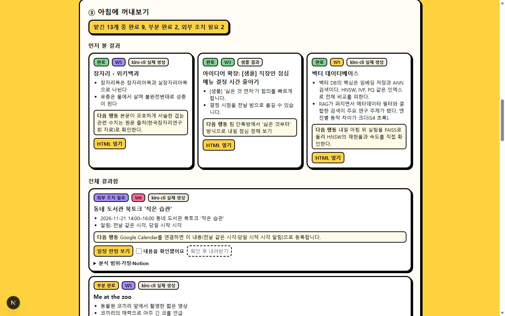
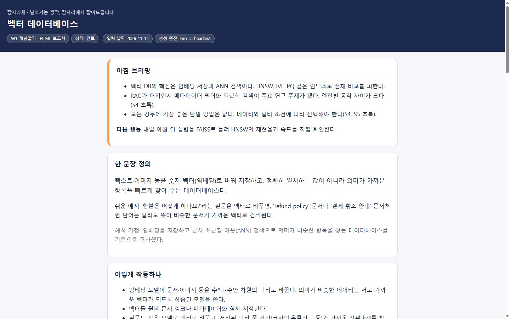
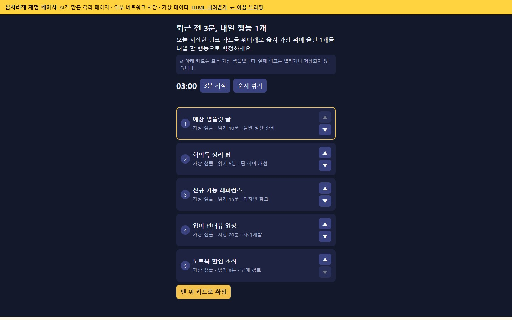

# 잠자리채 — 날아가는 생각, 잠자리에서 잡아드립니다

낮에 떠오른 생각·링크·사진을 저장만 하고 다시 정리하지 못하는 사람을 위한 앱입니다. 밤에 던져 두면 자는 동안 Kiro가 조사·정리하고, 아침에 HTML 보고서·영상·체험 URL·Google Calendar 일정으로 돌려주며 Notion에 날짜별로 기록합니다.

**Demo:** **https://youtu.be/Y3dt4JMZpzQ**, **http://localhost:3000** (개발자 PC에서 실행할 때만 동작합니다. 공개 URL은 없습니다) · 시연 순서와 화면별 주소는 [docs/DEMO.md](docs/DEMO.md)

**데모는 로컬에서만 작동합니다.** 작업 큐·워커·kiro-cli·Notion·Google Calendar 연결이 모두 개발자 PC에 있어서, 전체 흐름(담기 → 맡기기 → 꺼내보기)은 6절대로 `npm.cmd run dev`와 `npm.cmd run worker`를 실행한 뒤 http://localhost:3000 에서 확인합니다. Vercel에 올린 결과 보기 전용 페이지(https://jamjarichae.vercel.app)는 2026-11-14 16시대 실행 결과의 스냅샷일 뿐 현재 화면·기능과 다르고 담기·맡기기는 거부되므로 데모로 쓰지 않습니다.



- 문제 원문과 확정/제안 구분: [challenge.completed.md](challenge.completed.md)
- 활성 Spec: [.kiro/specs/jamjarichae/](.kiro/specs/jamjarichae/) (requirements → design → tasks, 작업 10개 완료)
- Kiro 활용 기록: [BUILD_REPORT.md](BUILD_REPORT.md) · 요구→코드→테스트→실측 대응표: [docs/evidence.md](docs/evidence.md) · 실제 실행 기록: [docs/integration-status.md](docs/integration-status.md) · 외부 스킬 적용: [docs/skill-adapters.md](docs/skill-adapters.md)
- 발표자료: [PRESENTATION.pdf](PRESENTATION.pdf) · 편집 가능한 [HTML 발표자료](PRESENTATION.html) (axis:ppt3, [라이선스](docs/axis-ppt3-LICENSE.txt))

---

## 1. 문제 정의

### 대상 사용자
낮에 떠오른 생각·영감·사진·링크를 메모 앱이나 채팅방에 저장해 두지만, 다시 열어 조사하고 정리할 시간이 없는 직장인·학생입니다. 첫 버전은 소유자 본인 1명이 쓰는 로컬 앱입니다.

### 문제 상황
- **누가**: 일하거나 이동하는 중에 "이 개념 뭐지?", "이 아이디어 키워 보고 싶다", "이 영상 나중에 봐야지", "이 행사 가야지"가 떠오른 사람이
- **어떤 상황에서**: 그 자리에서는 메모 한 줄이나 링크 하나로 저장만 하고 하던 일로 돌아가는데
- **무엇이 불편한지**: 저녁에는 다시 조사·정리할 집중력이 남아 있지 않습니다. 저장한 생각은 쌓이기만 하고, 일정은 놓치고, 아이디어는 한 줄에서 멈춥니다.

### 기존 방식과 한계
| 기존 방식 | 한계 |
|---|---|
| 메모 앱·나에게 보내기 | 저장은 쉽지만 조사·정리는 결국 사람이 다시 해야 합니다 |
| 챗봇에 직접 묻기 | 깨어 있는 동안 화면 앞에서 답을 기다려야 하고, 출처가 실제로 열리는지는 사람이 따로 확인해야 합니다 |
| 캘린더에 직접 입력 | 행사일과 신청 마감을 헷갈리거나, 연도·시각이 빠진 채 등록하기 쉽습니다 |

### 근거
- 대회 주제 "나와 주변 사람이 매일 겪는 작은 불편"에 맞춰, 팀원 본인이 매일 겪는 불편에서 출발했습니다. 문제 진술은 [challenge.completed.md](challenge.completed.md)에 **[확정]**으로 표시돼 있습니다.
- 설문이나 사용 기록 분석 같은 정량 조사는 하지 않았습니다. 지금 근거는 팀원 본인의 경험입니다.

### 목표
저장 이후의 조사·정리·확장은 사용자가 자는 동안 워커가 끝냅니다. 아침에는 "무엇이 끝났고 내가 무엇을 하면 되는지"만 확인하면 됩니다. 연결되지 않은 기능은 완료처럼 보이지 않게 상태로 드러냅니다.

---

## 2. 핵심 기능

| 기능 | 해결하는 불편 | 코드 위치 |
|---|---|---|
| ① **생각 담기**: 메모·URL·이미지 + 목적 4개(개념알기·아이디어확대·요약·일정잡기) + 결과 형태. 허용되지 않은 조합은 화면과 서버가 같은 규칙으로 막습니다 | 떠오른 순간 버튼 한 번으로 저장하고 하던 일로 돌아갑니다 | `src/domain/jamjarichae/contracts.ts`, `src/components/jamjari/JamjariApp.tsx`, `src/app/api/jamjari/jobs/route.ts` |
| ② **잠자리채에 맡기기**: 파일 기반 영속 큐 + 브라우저와 별개인 워커(lease·단계 체크포인트·재시도). 생성 엔진은 kiro-cli headless입니다 | 다시 조사·정리할 시간과 집중력이 없습니다. 브라우저를 닫아도 작업은 이어집니다 | `src/lib/jamjari/store.ts`, `worker.ts`, `kiro.ts`, `scripts/jamjari-worker.ts` |
| ③ **아침에 꺼내보기**: 첫 화면 카드 4개(① 목적이 뭐야? ② 밤 작업 보드 ③ 아침에 꺼내보기 ④ 전체 결과함). ①에 실제 상태 집계 브리핑과 "내 답변이 필요한 것", ②에 대기·진행 중 작업만, ③에 끝난 결과(HTML 열기·내려받기, 체험 URL, 일정 링크)와 "확인완료", ④에 확인완료한 결과를 쌓고 선택 삭제. 연결 상태는 Calendar·Notion을 실제 호출로 확인 | 아침에 무엇이 끝났고 무엇을 내가 해야 하는지 한눈에 봅니다 | `src/domain/jamjarichae/briefing.ts`, `render.ts`, `src/app/r/[id]/route.ts`, `src/app/p/[id]/` |

### 여섯 경로와 확인 상태 (2026-11-14 16:42 기준)

2026-11-14 16:02–16:13에 6경로를 화면에서 맡겨 실제로 끝까지 실행했습니다(근거: [docs/integration-status.md](docs/integration-status.md) 6절). 모든 작업은 kiro-cli headless가 생성했고, 숫자·날짜·출처 판정은 코드가 했습니다.

| 경로 | 결과물 | 실제 실행 결과 | 한계 |
|---|---|---|---|
| W1 개념 → HTML | 정의·원리·역사·최근 연구·출처가 있는 HTML | 메모 입력 58초(출처 6/6 접속 확인), 위키백과 URL 입력 44초(출처 4/4) | 이미지만 넣으면 `no_readable_input`으로 실패 표시(이미지 내용 분석 미연결) |
| W2 개념 → 영상 | 조사 결과로 만든 **로컬 MP4**(HyperFrames, 1920×1080) | 61초 영상, 장면 8개, 313초. `/v/…`에서 재생·내려받기 | Gemini Notebook은 공개 API가 영상 생성을 지원하지 않아 쓰지 않습니다. 계정·API 키 없이 로컬에서 렌더합니다 |
| W3 아이디어 → HTML | 서로 다른 아이디어 정확히 5개 | 35초. 코드가 개수·중복·변경 축을 검사 | 4개 이하면 재생성 후 부분 완료 |
| W4 아이디어 → 체험 URL | 단일 HTML/CSS/JS 원페이지(격리 iframe) | 27초. 버튼 클릭 시 투표 1/5→2/5 변화를 브라우저로 확인 | 생성된 버튼의 자동 클릭 검사는 워커에 없음 |
| W5 링크 → 요약 HTML | 웹페이지·유튜브 근거 요약 | 유튜브 40초(자막 + 실제 프레임 6장 + 시점 링크 6개), 위키백과 17초. 64분 영상·없는 영상은 오류로 표시 | 유튜브는 자막 기반이라 항상 부분 완료. AI의 화면 이해는 없음 |
| W6 일정 → 캘린더 | **Google Calendar 이벤트** + 전날·당일 알림 | 11초. 이벤트 생성 후 Calendar API로 다시 조회해 시작·종료·알림(1440분 전, 0분)을 확인하고 테스트 이벤트는 삭제 | 연도·시작 시각이 없거나 후보가 여러 개면 등록하지 않고 질문합니다 |

여섯 경로 작업은 모두 Notion에 `잠자리채 › 2026-11-14 › 경로 › 작업` 위치로 기록됩니다(REST로 조회해 확인). Notion 쓰기가 실패한 작업은 기록하지 않고 `not_configured`로 표시합니다.

아직 연결하지 않은 것: **Google 로그인**(OAuth 클라이언트 없음, 로컬 소유자 모드), **이미지 내용 분석**, **정시 자동 실행**(지금은 "맡기기" 버튼 또는 "바로 정리").
## 3. 사용 시나리오

1. **낮, 생각 담기**: 회의 중 "벡터 데이터베이스가 뭐지?"가 떠오릅니다. 메모에 적고 목적 **개념알기 → HTML 보고서**를 고른 뒤 **＋ 생각 담기**를 누릅니다. 행사 안내 문구는 **일정잡기**, 나중에 볼 유튜브 링크는 **요약**으로 담습니다.
2. **밤, 맡기기**: 자기 전에 **🌙 잠자리채에 맡기기**를 누르고 브라우저를 닫습니다. 시연용 기본값 **바로 정리**가 켜져 있으면 담는 즉시 처리를 시작합니다(오늘 실측 작업당 10초–1분). 별도 워커가 작업마다 kiro-cli를 빈 폴더에서 실행해 웹 검색·요약·아이디어 확장을 합니다. 출처 응답, 아이디어 개수, 일정 날짜는 코드가 판정합니다.
3. **아침, 꺼내보기**: 다시 열면 "맡긴 N개 중 완료 a, 부분 완료 b, 내 답변 필요 c"처럼 실제 상태를 센 브리핑이 보입니다. 먼저 볼 결과 3개의 핵심 발견과 다음 행동을 읽고 HTML·영상을 엽니다. 같은 기록이 Notion 날짜 페이지에 있고, 일정은 Google Calendar에 들어가 있습니다.
4. **후속 조치**: 체험 URL을 눌러 보고, "내 답변 필요" 질문에 답하면 그 작업이 다시 큐에 들어갑니다. 결과 HTML은 내용 확인을 체크한 뒤 파일로 내려받습니다.



| W1 개념 보고서 | W4 체험 페이지 |
|---|---|
|  |  |

## 4. 기대 효과

이 PC에서 실제로 잰 값입니다(근거: [docs/integration-status.md](docs/integration-status.md) 2·4절).

| 항목 | 값 |
|---|---|
| 생각 1건을 맡기는 사용자 조작 | 입력 후 버튼 2번(담기 1번 + 맡기기 1번. 맡기기는 여러 건을 한 번에 처리) |
| 결과를 기다리는 사용자 시간 | 0분. 처리는 사용자가 자는 동안 워커가 합니다 |
| 작업 1건 처리 시간(워커) | W6 일정 11초, W5 웹 요약 17초·유튜브 40초, W4 27초, W3 35초, W1 개념 조사 44–59초, W2 영상 313초 |
| 출처 확인 | 사람이 링크를 열어 볼 필요 없이 워커가 출처마다 접속 응답을 기록(실측 W1 6/6, 4/4 응답) |
| 일정 오등록 방지 | 행사일과 신청 마감을 코드가 분리합니다. 연도·시작 시각이 없거나 후보가 여러 개면 등록하지 않고 질문합니다(자동 테스트 14개) |
| 중단 복구 | 작업 중 워커를 강제 종료해도 새 워커가 끝난 단계부터 이어서 완료(실측 4분 7초, 입력 수집 단계 재실행 없음) |

기존 방식(직접 검색·정리) 대비 절감 시간은 사용자 실험으로 재지 않았습니다.

## 5. 차별점

| 비교 대상 | 잠자리채가 다른 점 |
|---|---|
| 챗봇 | 화면 앞에서 기다리지 않습니다. 영속 큐와 별도 워커라 브라우저를 닫거나 새로고침해도 작업이 이어지고, 워커가 죽어도 체크포인트부터 재개합니다 |
| 메모·북마크 앱 | 저장에서 끝나지 않고, 목적(개념·아이디어·요약·일정)에 맞는 결과물(HTML·체험 URL·일정 판정)까지 만듭니다 |
| 모델 자기 보고에 기대는 AI 도구 | 판정은 코드가 합니다. 허용 조합, 입력 날짜(KST), 아이디어 5개·중복·변경 축, 체험 HTML 안전 검사, 일정 모호성, 출처 접속 응답을 코드가 확인합니다 |
| 완료처럼 보이는 데모 | 안 된 것은 안 됐다고 표시합니다. 미연결 기능은 가짜 URL을 만들지 않고 "외부 조치 필요"나 "부분 완료"로 멈추고, 샘플 결과에는 "샘플" 배지를 붙입니다 |

안전 장치도 있습니다.
- 사용자 입력은 데이터 블록으로만 stdin에 넘깁니다.
- 신뢰 도구는 경로별 고정 목록입니다. W1·W2만 웹 도구를 씁니다.
- URL 수집기는 사설·루프백·메타데이터 주소를 차단합니다.
- 보고서에는 스크립트를 허용하지 않는 CSP를 붙입니다.

---

## 6. 설치와 실행

필요한 것: Windows, Node 22, kiro-cli 3.3(로그인된 상태). W5 유튜브 요약에는 `yt-dlp`와 `ffmpeg`가 PATH에 있어야 합니다. W2 영상 렌더는 `hyperframes`(devDependency)를 씁니다. Notion·Google Calendar 연결은 선택이며 `.env.local`에 토큰을 넣을 때만 켜집니다([.env.example](.env.example)). 연결하지 않으면 해당 단계는 "연결 필요"로 멈춥니다.

```powershell
# 1. 의존성 설치
git clone https://github.com/stat-yongsan/kirothon-team-030.git
cd kirothon-team-030
npm.cmd install

# 2. 실행 (터미널 2개)
npm.cmd run dev        # 터미널 1: 화면 http://localhost:3000
npm.cmd run worker     # 터미널 2: 야간 워커. 꺼져 있으면 화면에 "워커 꺼짐"이 보이고 작업은 대기 상태로 남음
```

macOS·Linux에서는 `npm.cmd` 대신 `npm`을 씁니다(이 환경에서는 확인하지 않았습니다).

휴대폰에서 쓰려면 PC와 같은 Wi-Fi에 연결한 뒤 프로덕션 서버를 네트워크에 엽니다. 휴대폰 브라우저에서 `http://<PC의 IP>:3001`을 엽니다. 같은 네트워크의 누구나 열 수 있으므로 믿을 수 있는 네트워크에서만 씁니다.

```powershell
npm.cmd run build
npm.cmd run start -- -p 3001 -H 0.0.0.0   # 워커는 그대로 npm.cmd run worker
```

kiro-cli 없이 보려면 화면의 **샘플 모드**를 켜고 예시 버튼(개념잡기·아이디어 확장하기·일정잡기)으로 담은 뒤 맡깁니다. kiro-cli 호출과 외부 접속 없이 같은 파이프라인을 지나고, 결과에 "샘플"이 표시됩니다. 데이터는 `.data/jamjarichae/`(git 제외)에 저장됩니다. 선택 환경변수는 [.env.example](.env.example)에 있습니다.

## 7. 테스트

```powershell
npm.cmd run test                            # Vitest 138개(파일 9개)
node scripts/quality.mjs task               # typegen + typecheck + test
node scripts/quality.mjs release --force    # lint + typegen + typecheck + test + build
```

| 테스트 파일 | 확인하는 것 |
|---|---|
| `src/domain/jamjarichae/contracts.test.ts` | 6경로 허용/거부 조합, URL·이미지·메모 상한, KST 자정 경계 입력 날짜 |
| `src/domain/jamjarichae/schedule.test.ts` | 행사+마감 혼재, 연도 누락, 후보 2개, 지난 일정, 종료 누락 가정, 알림 시각 |
| `src/domain/jamjarichae/outputs.test.ts` | 아이디어 5개·중복·축 검사, 체험 HTML의 네트워크·외부 리소스·저장소 차단, 로그 섞인 JSON 추출 |
| `src/domain/jamjarichae/briefing.test.ts` | 상태 집계와 먼저 볼 결과 3개 |
| `src/domain/jamjarichae/video.test.ts` | W2 영상 장면 길이 계산·구성 HTML 생성 |
| `src/lib/jamjari/store.test.ts` | 생성·중복 키·점유·lease 만료 재점유·취소 |
| `src/lib/jamjari/worker.test.ts` | 가짜 엔진으로 6경로, 체크포인트 재개 시 엔진 재호출 0회, 입력이 도구 목록을 못 바꿈, 샘플 모드 외부 호출 0회 |
| `src/lib/jamjari/fetch-url.test.ts` | 사설·루프백·메타데이터 주소와 리다이렉트 차단 |
| `src/app/api/jamjari/api.test.ts` | 헤더 없는 쓰기·다른 Origin 403, 조합 거부 422, 중복 담기, 취소 409, 경로 조작 404, 보고서·체험 CSP |

마지막 검사 결과와 시각은 [docs/evidence.md](docs/evidence.md) 4절에 있습니다. 실제 kiro-cli 연동은 자동 테스트가 아니라 실제 실행으로 확인했고 [docs/integration-status.md](docs/integration-status.md)에 기록했습니다.

---

## 저장소 구성

| 위치 | 내용 |
|---|---|
| `src/domain/jamjarichae/` | 계약·판정·브리핑·렌더(코드가 판정하는 규칙) |
| `src/lib/jamjari/` | 저장소·워커·kiro-cli 실행·URL 수집기·유튜브 |
| `src/app/api/jamjari/`, `src/app/r/`, `src/app/p/` | API·보고서·체험 뷰어 |
| `src/components/jamjari/` | 한 페이지 UI |
| `scripts/jamjari-worker.ts` | 워커 프로세스 |
| `scripts/quality.mjs` | 검사 스크립트(save·task·release) |
| `.kiro/` | specs·steering·agents·settings(MCP) |
| `docs/` | 시연 대본, 근거 대응표, 실행 기록, 스킬 적용 기록, 인계 파일, 스크린샷 |

## 팀

- **팀 번호:** team-030
- **팀명:** AX:IS

| 이름 | 역할 |
|---|---|
| stat-yongsan | 기획·설계·개발·시연(1인) |
